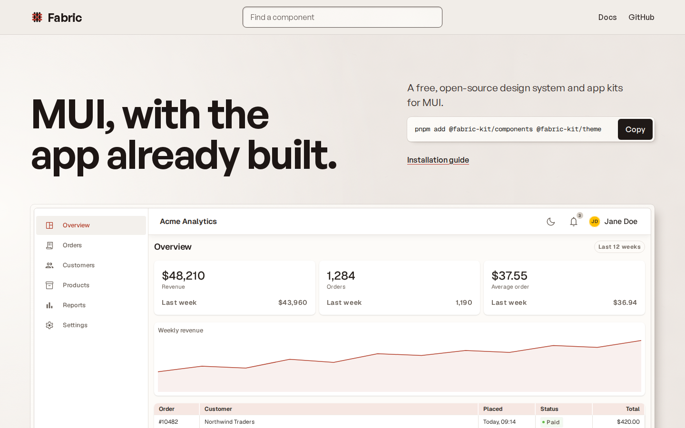

<p align="center">
  
</p>

<p align="center">
  <strong>MUI, with the app already built.</strong><br />
  A free, open-source design system and set of app kits on top of <a href="https://mui.com">MUI</a>.
</p>

<p align="center">
  <a href="https://ahmedbilal5.github.io/fabric/">Website</a> ·
  <a href="https://ahmedbilal5.github.io/fabric/docs/">Documentation</a> ·
  <a href="https://ahmedbilal5.github.io/fabric/docs/?path=/docs/foundations-installation--docs">Installation</a> ·
  <a href="CONTRIBUTING.md">Contributing</a>
</p>

<p align="center">
  
</p>

---

Fabric gives your React app a warm, consistent look and the screens most products need, without giving up anything MUI offers:

- **A theme** with light and dark modes, built from design tokens, plus `createFabricTheme` to make it your brand.
- **Components**: MUI components with better defaults and the props you end up adding anyway (button loading and menus, data-driven selects, dialogs with actions, status tags).
- **Data controls**: the free, MIT-licensed MUI X data grid, date pickers and tree view, styled to match.
- **Kits for whole features**: an app shell, a search palette, a streaming AI assistant, version history and a workflow canvas. Kits take async functions, so they work with any backend.
- **3,300+ icons** from Material Symbols, plus every `@mui/icons-material` name.

Everything is MIT licensed. Fabric uses only free MUI packages, so you never need an MUI X license key.

## Quick start

```bash
pnpm add @fabric-kit/theme @fabric-kit/components @fabric-kit/icons \
  @mui/material @mui/lab @mui/x-date-pickers @mui/icons-material \
  @emotion/react @emotion/styled @fontsource/geist @fontsource/geist-mono
```

```tsx
import "@fontsource/geist/400.css";
import "@fontsource/geist/600.css";
import { DesignSystemProvider } from "@fabric-kit/theme";
import { FabricButton } from "@fabric-kit/components";

export function App() {
  return (
    <DesignSystemProvider>
      <FabricButton variant="contained">Get started</FabricButton>
    </DesignSystemProvider>
  );
}
```

The [installation guide](https://ahmedbilal5.github.io/fabric/docs/?path=/docs/foundations-installation--docs) covers Next.js, dark mode, fonts and troubleshooting.

## Packages

| Package                                                               | What it is                                                       |
| --------------------------------------------------------------------- | ---------------------------------------------------------------- |
| [`@fabric-kit/design-tokens`](packages/design-tokens)                 | Color, type, spacing, radii, shadows and motion as plain values. |
| [`@fabric-kit/theme`](packages/theme)                                 | The MUI theme, `DesignSystemProvider` and `createFabricTheme`.   |
| [`@fabric-kit/primitives`](packages/primitives)                       | Flex, Stack, Inline, Grid, Text and Surface.                     |
| [`@fabric-kit/icons`](packages/icons)                                 | Tree-shakeable Material Symbols icons.                           |
| [`@fabric-kit/components`](packages/components)                       | MUI components with Fabric defaults and extra props.             |
| [`@fabric-kit/datagrid`](packages/advanced-components/datagrid)       | The free MUI X data grid, styled.                                |
| [`@fabric-kit/date-picker`](packages/advanced-components/date-picker) | Date, time and date-range pickers.                               |
| [`@fabric-kit/tree-view`](packages/advanced-components/tree-view)     | The free MUI X tree view, styled.                                |
| [`@fabric-kit/layout`](packages/kits/layout)                          | App shell, sidebar, top bar, banner, footer and notifications.   |
| [`@fabric-kit/global-search`](packages/kits/global-search)            | A grouped search palette and a results page.                     |
| [`@fabric-kit/chatbot`](packages/kits/chatbot)                        | A streaming assistant panel for any backend.                     |
| [`@fabric-kit/versioning`](packages/kits/versioning)                  | A version history drawer.                                        |
| [`@fabric-kit/canvas-builder`](packages/kits/canvas-builder)          | A node-based workflow canvas on React Flow.                      |

## Development

Requires Node 22 and pnpm 9.

```bash
pnpm install
pnpm build        # build every package
pnpm storybook    # docs at http://localhost:6007
pnpm site:dev     # the landing page
```

See [CONTRIBUTING.md](CONTRIBUTING.md) for the workflow and [CLAUDE.md](CLAUDE.md) for the architecture rules.

## License

[MIT](LICENSE). Icons are derived from Google's Material Symbols (Apache 2.0); see [`packages/icons/NOTICE`](packages/icons/NOTICE). Fabric is not affiliated with MUI.
